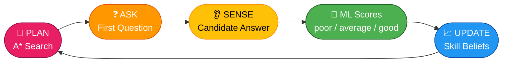

# AI_Project_AI_Interview_Intelligence_Agent_Sem_5th
<div align="center">

# 🤖 Interview Agent

### 🎯 AI-Powered, Utility-Driven Interview Assistant

<i>A\* Search + Machine Learning se smart interview questions select karta hai aur candidate ki skills ka andaza lagata hai.</i>

<br>


</div>

---

## ✨ Overview

**Interview Agent** ek *model-based, utility-driven* agent hai jo candidate se interview questions poochta hai, uske jawab ko **ML model** se score karta hai, aur har jawab ke baad apni **skill beliefs** update karke agla best question plan karta hai.

> ⚠️ **Note:** Yeh sirf **decision support** tool hai — hiring ka final faisla nahi.

---

## 🔄 Agent Loop



---

## 🧩 Features

| | Feature | Detail |
|---|---|---|
| 🔴 | **A\* Planning** | Time budget ke andar best questions ka set chunta hai |
| 🟠 | **BFS Baseline** | A\* se comparison ke liye uninformed search |
| 🟡 | **ML Answer Scoring** | TF-IDF + Logistic Regression / Naive Bayes |
| 🟢 | **Belief Update** | Har answer ke baad skill (1–3) update hoti hai |
| 🔵 | **Weka Export** | Dataset `.arff` aur `.csv` dono me |
| 🟣 | **Simulation Mode** | Fake candidate se demo chalao |

---

## 📚 Question Bank

**5 topics × 3 difficulty levels = 15 questions**

| Topic | 🟢 Easy (2 min) | 🟡 Medium (3 min) | 🔴 Hard (5 min) |
|---|---|---|---|
| 🐍 **Python** | List vs tuple | Decorators & generators | GIL & multithreading |
| 🧱 **DataStructures** | Stack vs queue | Hash table collisions | BST, AVL, heap complexity |
| 🤖 **MachineLearning** | Overfitting | Precision vs recall | Regularization + cross-validation |
| 🗄️ **Databases** | Primary key | Normalization & indexes | Transactions, isolation, deadlocks |
| 💬 **Behavioral** | Tell me about yourself | Team conflict | Failure & what you changed |

---

## 🗂️ Project Structure

```text
interview_agent/
├── 🧠 agent.py            # InterviewAgent class + simulated/interactive candidate
├── 🔍 search.py           # A* aur BFS search
├── 📝 question_bank.py    # Topics, difficulty aur questions
├── 🤖 ml_model.py         # Synthetic dataset + classifier pipeline
├── 🏋️ train.py            # Model train karke model.pkl save karta hai
├── 📊 evaluate.py         # ML metrics, A* vs BFS, failure modes
├── 📤 export_dataset.py   # answers.csv / answers.arff banata hai
├── ▶️ main.py             # Demo entry point
├── 📦 requirements.txt
├── 💾 model.pkl           # Trained model
├── 📄 answers.csv         # Dataset (Excel / Pandas)
└── 📄 answers.arff        # Dataset (Weka)
```

---

## 🚀 Installation

```bash
# 1️⃣ Project folder me jao
cd interview_agent

# 2️⃣ Dependencies install karo
pip install -r requirements.txt
```

---

## ▶️ Usage

### 1️⃣ Model train karo

```bash
python train.py
```

### 2️⃣ Simulated candidate ke saath demo

```bash
python main.py --simulate
```

### 3️⃣ Khud interview do (interactive)

```bash
python main.py --interactive
```

### 4️⃣ Custom time budget (minutes)

```bash
python main.py --simulate --budget 30
```

### 5️⃣ Evaluation chalao

```bash
python evaluate.py
```

### 6️⃣ Dataset export karo (Weka / Excel)

```bash
python export_dataset.py
```

---

## 📤 Sample Output

```json
{
  "skills": {
    "Python": 2.8,
    "DataStructures": 2.3,
    "MachineLearning": 1.6,
    "Databases": 2.0,
    "Behavioral": 2.9
  },
  "overall": 2.32,
  "summary": "Strong",
  "questions_asked": 7,
  "minutes_used": 22
}
```

*(Numbers example ke liye hain — actual values har run me alag ho sakti hain.)*

### 🏆 Rating Levels

| Overall Score | Result |
|:---:|:---:|
|  | Bohot acha performance |
|  | Theek-thaak |
|  | Improvement chahiye |

---

## 🧮 How It Works

### 🔍 A\* Search
| Part | Definition |
|---|---|
| **State** | Plan me poochay gaye question ids ka set |
| **Action** | Ek naya question poochna |
| **Goal** | Har topic ka evidence ≥ 1.0 |
| **Cost** | `time/10 + abs(difficulty - estimated_skill)` |
| **Heuristic** | Uncovered topics ka minimum step cost (admissible) |

### 🧠 ML Model
- 🔤 **Features:** TF-IDF (unigrams + bigrams)
- 🎓 **Classifiers:** Logistic Regression, Multinomial Naive Bayes
- 🏷️ **Classes:** `0 = poor`, `1 = average`, `2 = good`
- 🧪 **Data:** 900 **synthetic** answers (20% label noise), 75/25 train-test split

### 📈 Belief Update

```text
skill[topic] = (1 − α) × skill[topic] + α × (class + 1)      α = 0.6
```

---

## ⚠️ Limitations

- 🧪 Dataset **synthetic** hai (keyword pools se bana), real interview data nahi.
- 🎭 **Keyword stuffing** se model ko dhoka diya ja sakta hai (gaming risk).
- ✂️ Chhote lekin sahi jawab (jaise `"use hash"`) ko model kam score de sakta hai.
- ⚖️ Output sirf **support** ke liye hai, hiring decision ke liye nahi.

---

## 🔮 Future Improvements

- [ ] 📚 Real labelled interview data
- [ ] 🧬 Transformer / embedding based scoring
- [ ] 🛡️ Keyword-stuffing detection
- [ ] 🌐 Web UI (Streamlit / Flask)
- [ ] 🗃️ Bara question bank

---

<div align="center">

### 💜 Made with Python, A\* & Machine Learning


</div>
